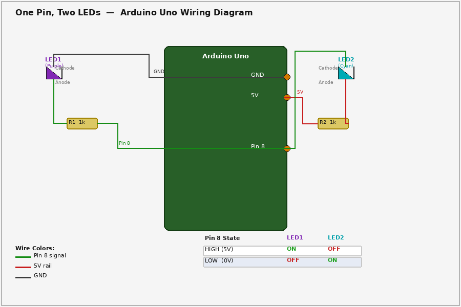

# One Pin, Two LEDs

This Arduino Uno demonstration uses one digital output to make two LEDs alternate. The sketch drives digital pin 8 HIGH and LOW; the opposite-polarity wiring makes one LED conduct in each state.

## How it works

- Pin 8 HIGH: the LED connected from pin 8 toward GND is on; the LED connected from +5 V toward pin 8 is off.
- Pin 8 LOW: the first LED is off; the second LED is on.
- The sketch waits 1,000 ms in each state, so the active LED changes about once per second.

The LEDs are not controlled by separate software outputs. The alternating behavior depends on the circuit being wired with the two LEDs in opposite directions.

## Components

| Component | Quantity | Notes |
|---|---:|---|
| Arduino Uno (5 V logic) | 1 | Sketch uses digital pin 8 |
| LEDs | 2 | Any suitable LED; forward voltage affects current |
| 1 kΩ resistor | 2 | One in series with each LED |
| Breadboard and jumper wires | As needed | For the low-voltage circuit |

## Wiring

| Path | Connections |
|---|---|
| LED 1 | Pin 8 → 1 kΩ resistor → LED anode; LED cathode → GND |
| LED 2 | +5 V → 1 kΩ resistor → LED anode; LED cathode → pin 8 |

Use a current-limiting resistor for each LED. Do not connect an LED directly across the supply or an output pin. This wiring guide is for a 5 V Arduino Uno; do not assume the same circuit is appropriate for a 3.3 V board without checking its electrical limits.

## Files in the repository

| Path | Purpose |
|---|---|
| `sketch.ino` | Arduino sketch; toggles pin 8 HIGH/LOW with 1-second delays |
| `wiring_diagram.png` | Wiring diagram stored at the repository root |
| `explanation.md` | Circuit principle and current-limiting explanation |
| `LICENSE` | MIT license |
| `README.md` | Project instructions |

The sketch and diagram are at the repository root. The older paths `src/one_pin_2_leds.ino` and `diagram/wiring_diagram.png` are not present in the checked-in tree.

## Upload the sketch

1. Assemble the circuit with power disconnected and check both LED polarities and resistor placement.
2. Open the checked-in `sketch.ino` in Arduino IDE.
3. Select **Arduino Uno** under **Tools → Board** and the correct port under **Tools → Port**.
4. Upload the sketch, then power the circuit and confirm that the LEDs alternate.
5. If the IDE asks for a matching sketch folder, use a local working copy; do not rename repository files as part of this documentation update.

There are no external Arduino libraries used by this sketch. Change `ledPin` to another valid digital output only if you also update the wiring. Change the `delay(1000)` values to alter the interval.

## Simulation

The project has a Wokwi simulation link: https://wokwi.com/projects/465977896205616129. The link is provided as a reference; this maintenance pass did not run the simulation or test physical hardware.

## Troubleshooting

- **Only one LED lights:** check that the two LEDs face opposite directions and that both series resistors are installed.
- **Neither LED lights:** verify pin 8, GND, +5 V, LED polarity, and the selected board/port.
- **Brightness differs:** LED forward voltage and component tolerances affect current; keep the current-limiting resistors installed.

## License

MIT. See [`LICENSE`](LICENSE).

---

## Maintenance & Audit

- **Audit date:** 11 November 2026
- **Documentation status:** README reviewed and audit record added on this date.
- **Scope and evidence:** Documentation review of `sketch.ino`, `explanation.md`, `wiring_diagram.png`, and the existing README. The file paths above were checked against the default branch.
- **Code and tests:** No sketch changes were made; no compilation, simulation, or physical hardware test was performed.
- **Maintenance baseline:** Documentation status recorded through 11 November 2026; recheck the circuit, sketch, and diagram if pin usage or hardware changes.
